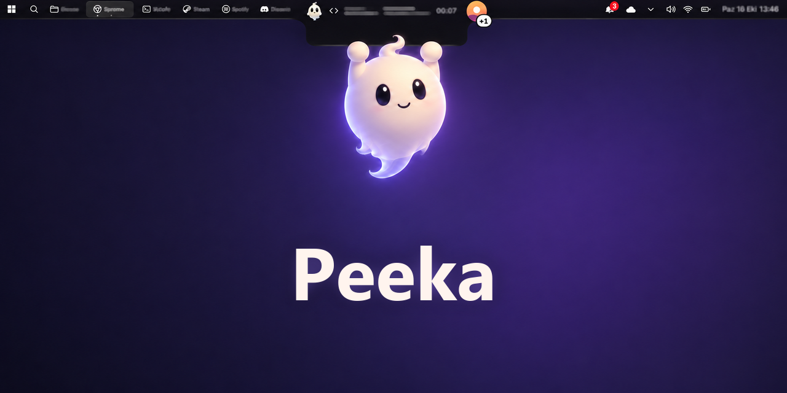
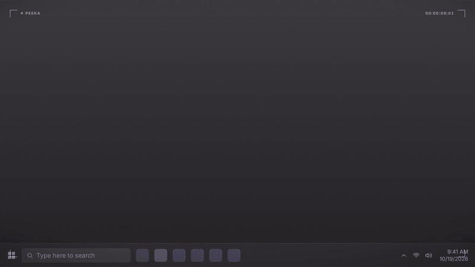
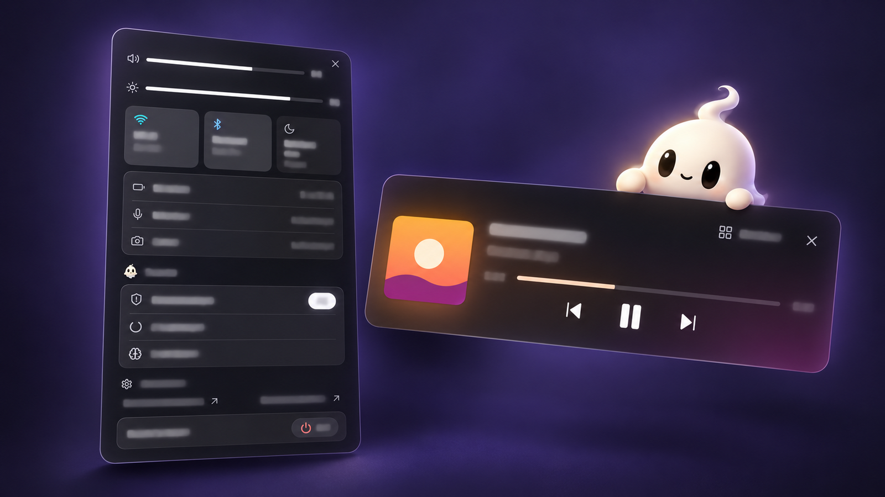

<div align="center">



<h1>Peeka</h1>

<p><b>A Dynamic-Island-style top strip for Windows, with a ghost that keeps you company.</b></p>

<p>
  <a href="https://github.com/isDionn/peeka/actions/workflows/ci.yml"></a>
  <a href="https://github.com/isDionn/peeka/releases/latest"></a>
  <a href="LICENSE"></a>
</p>

<p>
  <a href="https://github.com/isDionn/peeka/releases/latest/download/Peeka-setup.exe"><b>Download for Windows</b></a>
  <br><sub>v0.3.5 · ~4.6 MB · Windows 10/11 · <a href="#download">other downloads and SmartScreen note</a></sub>
</p>



<p><sub>▶ <a href="https://isdionn.github.io/peeka/#trailer">Watch the 30-second trailer</a> (with sound)</sub></p>

<p>
  <a href="#download">Download</a> ·
  <a href="#features">Features</a> ·
  <a href="#privacy">Privacy</a> ·
  <a href="#build-from-source">Build</a> ·
  <a href="#plugins">Plugins</a> ·
  <a href="#license">License</a> ·
  <a href="#türkçe">Türkçe</a>
</p>

</div>

## What is Peeka?

Peeka replaces the Windows taskbar with a thin strip along the top of the screen. In its middle sits an **island** that grows into a card when something happens: a song starts, a download finishes, a timer runs out, Claude Code asks for permission. Next to it lives a small ghost mascot that reacts to what the island is doing.

It runs locally, sends nothing anywhere, and other programs can add their own cards through a public plugin API.

<p align="center">
  
</p>

## Features

### The shell

- 📏 **Strip**: a top bar that does the taskbar's job: running apps, tray, start and search, system status. Clicking it does not steal focus from the app you are working in. Hover an app to see a live window preview.
  - App icons only; when they don't fit, a **+N** button shows the rest. Click the app in front to minimise it.
  - Import your Windows taskbar pins (Settings › Appearance). A pinned app that is running shows once, not twice.
  - **Start** opens with the Win key and has folders; right-click menus, a **Show desktop** button, hidden tray icons you can reorder and group.
  - Optional strips on your other monitors; a fullscreen game on one screen leaves the others alone.
- 🏝️ **Island**: the central pill expands into cards for whatever is happening right now: media, alerts, a running timer, a finished download, a Claude Code session, plugin cards. Its home view, **Places**, keeps every module (music, calendar, timer, clipboard and more) in a fixed spot.
- ✨ **Drift glow**: a soft light inside the strip and island that takes its colours from what is on your screen.
- 💬 **Side bubble**: short, quiet messages next to the island instead of full pop-ups.
- 👻 **Mascot**: a ghost that hangs below the island and reacts to its state.
- 🧭 **Setup wizard**: three steps on first launch (taskbar, optional notification mirror, Windows banners), available again any time.

### Everyday tools

- 📋 **Clipboard (Pano)**: history of text, images and file paths. Password-like items are recognised, shown blurred, and never handed to plugins; a vault keeps them encrypted with Windows DPAPI.
- 🎵 **Media**: the current track from Windows media sessions, with play, pause, skip and seeking (controls appear on hover), plus volume per app.
- 🗂️ **Shelf**: drop files on it to keep them at hand; they stay until you remove them.
- 📅 **Calendar, Wi-Fi and Bluetooth**: Peeka's own calendar and network pickers from the strip.
- 🔔 **Notifications**: an optional mirror of Windows notifications, plus a list of Peeka's own. One-time codes can be copied with one click.
- ⏱️ **Timer**: a countdown that lives in the island.
- 🖥️ **System**: CPU and memory, battery thresholds, volume, brightness and Bluetooth or radio changes, shown as brief island events. A download-finished notice shows names and sizes only; files are never opened.

### For developers

- 🤖 **Claude Code integration**: one button in Settings adds Peeka's hook entries to Claude Code's `settings.json`, and another removes exactly those entries. Sessions, tool use and permission requests then show up in the island. The hook only reports events and prints nothing, so Claude Code's own prompts stay unchanged.
- 🧩 **Plugins**: any program can add island items, cards, search results and alerts over a local named pipe. You approve each plugin scope by scope and can disconnect it at any time. See [Plugins](#plugins).

## Privacy

- 🏠 **Everything stays local.** Peeka's only network request is one daily check for a newer version: a plain GET of `api.github.com/repos/isDionn/peeka/releases/latest` that sends nothing but a `Peeka/<version>` User-Agent (no cookies, no ID, no data about you or your PC) and reads the version number from the reply. Turn it off in Settings › "Check for updates". No analytics or telemetry. The web UI's content security policy only allows `self` and Tauri IPC.
- 🙈 **Lock and presentation modes.** Peeka locks when Windows locks, on demand, or when a plugin asks (a plugin can never unlock). While locked, or while Windows is in presentation mode, the strip and bubble show generic labels instead of content, password rows are hidden, and nothing is sent to plugins.
- 🌫️ **Passwords are blurred.** Password rows in the clipboard stay blurred until you hover or focus them; the real text is not in the page until then and disappears as soon as you leave.
- ⏲️ **One-time codes clean up after themselves.** A code copied from a notification is cleared from the clipboard after 60 seconds, unless you have copied something else since.
- 🔔 **Notification mirror is read-only and off by default.** When you turn it on, Peeka reads your own Windows notification history (read-only, never written, no copy), keeps the cards in memory only, and does not start while Windows' notification access switch is off.
- 🎙️ **Mic and camera indicator.** A dot shows which apps are using the microphone or camera, read from Windows' own consent store.
- 📡 **Local listeners only.** A per-user named pipe for plugins, and an optional alert API on `127.0.0.1` that is off by default and needs a per-install key.
- 🎨 **Screen colours stay in memory.** The Drift glow samples a few pixels under the strip; they are never written to disk, logs or plugins, and sampling pauses while locked, presenting, sharing your screen or in fullscreen. You can turn it off (Settings › Screen colour glow).
- 🩺 **Diagnostics are local.** Ctrl+Alt+Shift+D saves a text file for bug reports (versions, screen sizes) with no window titles, clipboard, user name or paths; nothing is sent.
- 📁 Your data (settings, clipboard vault, plugin tokens stored as SHA-256 only) lives in `%LOCALAPPDATA%\notch`.

Plugins may use their own internet connection; Peeka cannot control that, and the approval window says so.

## Download

From the [latest release](https://github.com/isDionn/peeka/releases/latest), download **`Peeka-<version>-setup.exe`** (installer, adds a Start menu entry and an uninstaller) or **`peeka.exe`** (portable, just run it). Windows 10/11; WebView2 is already part of Windows 11.

> [!NOTE]
> The exe is not code-signed yet, so Windows SmartScreen may say "Windows protected your PC". Click **More info → Run anyway**. You can always [build it from source](#build-from-source) instead.

Not happy with it? Press **Restore taskbar** in Settings › Appearance and your normal taskbar is back.

## Build from source

Built with Rust, Tauri 2 and React 19.

### Prerequisites

- Windows 10 or 11 with the **WebView2** runtime (preinstalled on Windows 11)
- **Rust**, stable, with the MSVC toolchain
- **Node.js** and **pnpm**

### Build

```powershell
cd ui
pnpm install --frozen-lockfile
pnpm build                       # tsc + vite, output in ui/dist
cd ..
cargo build --release -p notch-app --features tauri/custom-protocol
```

The app is `target/release/peeka.exe`.

<details>
<summary><b>Notes for developers</b></summary>

- The `custom-protocol` feature embeds `ui/dist` into the exe. A plain `cargo build` does not: the window then loads the dev URL (`http://127.1.2.7:5174`, served by `pnpm dev` in `ui/`) and shows nothing without that server.
- Tests: `cargo test` in the repo root, `pnpm test` in `ui/`.
- Internally the code name `notch` is still used for the Cargo package, the `%LOCALAPPDATA%\notch` data folder and the pipe name.

</details>

## Plugins

Plugins talk to Peeka over JSON-RPC 2.0 on a user-only named pipe. They send data; Peeka draws it. No HTML, CSS or scripts from plugins, scoped permissions, and an approval window that Peeka draws itself.

- 📜 Contract: [`docs/plugin-api.md`](docs/plugin-api.md)
- 🛠️ SDK examples in Python and Node: [`sdk/README.md`](sdk/README.md)

## Contributing

Issues and pull requests are welcome. Please keep changes small and focused, and run `cargo test` and `pnpm test` in `ui/` before opening a PR. Forks must replace the mascot with their own artwork (see below).

## License

The source code is MIT, see [`LICENSE`](LICENSE).

The mascot is not: the ghost character and its artwork are © 2026 isDionn, all rights reserved; see [`MASCOT-LICENSE.md`](docs/MASCOT-LICENSE.md). Third-party notices: [`THIRD_PARTY_NOTICES.md`](docs/THIRD_PARTY_NOTICES.md).

---

## Türkçe

Peeka, Windows görev çubuğunun yerine geçen ince bir üst şerit ve ondan açılan "ada" (Dynamic Island benzeri) arayüzüdür. Şerit, ada, yan baloncuk, pano geçmişi, medya, Raf (Shelf), takvim, Wi-Fi ve Bluetooth seçicileri, uygulama başına ses, bildirimler, zamanlayıcı, sistem durumu, ekran renklerini alan Drift ışığı, hayalet maskot, Claude Code bağlayıcısı ve herkese açık eklenti API'si içerir. Windows görev çubuğundaki sabitlenmiş uygulamalar içe aktarılabilir; Win tuşu Peeka Başlat'ı açar.

- **İndirme:** [Son sürümden](https://github.com/isDionn/peeka/releases/latest) kurulum dosyasını (`Peeka-<sürüm>-setup.exe`) ya da taşınabilir `peeka.exe` dosyasını indirin. Exe henüz imzalı değil; SmartScreen uyarırsa **Ek bilgi → Yine de çalıştır**.
- **Kaynaktan derleme:** Yukarıdaki adımlar. Gereksinim: WebView2'li Windows 10/11, Rust (MSVC), Node.js ve pnpm. Düz `cargo build` arayüzü gömmez, `custom-protocol` özelliği şarttır.
- **Gizlilik:** Yerel çalışır, dışarıya kendi isteği yok, telemetri yok. Kilitte ve sunum modunda içerik yerine genel etiket görünür; parolalar bulanık durur; bildirimden kopyalanan tek kullanımlık kod 60 saniye sonra panodan silinir. Eklentiler her biri sizin onayınızla, kapsam kapsam bağlanır; kilitliyken eklentilere hiçbir şey gitmez.
- **Eklentiler:** Sözleşme [`docs/plugin-api.md`](docs/plugin-api.md), örnekler [`sdk/README.md`](sdk/README.md).
- **Lisans:** MIT. Maskot: hayalet karakter ve görselleri MIT dışındadır, hakları saklıdır; bkz. [`MASCOT-LICENSE.md`](docs/MASCOT-LICENSE.md).
